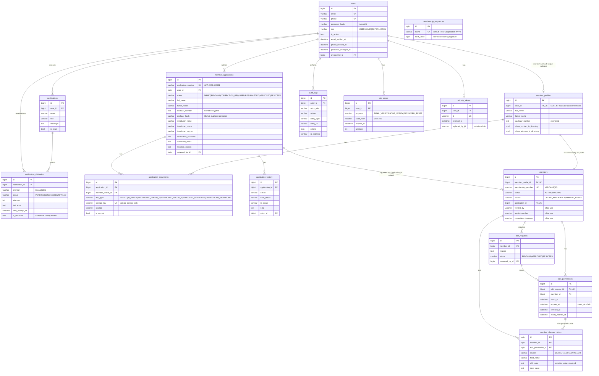

# Database ER diagram

MySQL 8, `utf8mb4`. All timestamps are stored as UTC `DATETIME` and returned by the API as ISO-8601 with a `Z` offset.
Schema source of truth: `backend/app/models/entities.py`; migration: `backend/alembic/versions/0001_initial_schema.py`.

## Key integrity rules

| Rule | How it is enforced |
|---|---|
| Unique email / phone / application no. / membership no. | `UNIQUE` constraints |
| One official membership per profile | `members.member_profile_id UNIQUE` |
| One membership per login account | `member_profiles.user_id UNIQUE` |
| Every approved application has a member record | Created in the same transaction; `members.application_id UNIQUE` |
| Manually added members need no account | `member_profiles.user_id` nullable |
| No duplicate membership numbers under concurrency | Sequence row `SELECT … FOR UPDATE` + unique constraint; tested with 8 parallel approvals |
| Membership number only on approval | Generated inside `approve_application`; pending applications have no member row |
